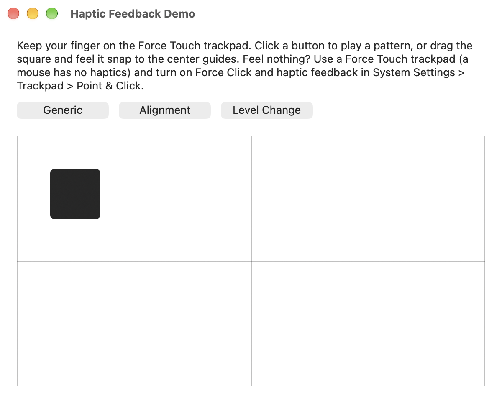

# Haptic Feedback Manager for Xojo

A small Xojo class that wraps AppKit's [`NSHapticFeedbackManager`](https://developer.apple.com/documentation/appkit/nshapticfeedbackmanager), so your macOS Xojo apps can play a physical "click" on a Force Touch trackpad, the same way macOS does when a shape snaps to a guide in Keynote or a window edge lines up with another one. People can feel that something happened without looking.

Includes a demo app with buttons for each feedback pattern and a square you can drag that snaps to center guides.



## Requirements

- macOS with a Force Touch trackpad (built into most MacBooks, or a Magic Trackpad)
- Xojo 2026 R3.1 or later (the project is saved in Xojo text format)
- **Force Click and haptic feedback** turned on in **System Settings > Trackpad > Point & Click**

On Windows and Linux the class compiles, but does nothing.

## Using the class in your own project

1. Copy `HapticFeedbackManager.xojo_code` into your project folder and add it to your project (or drag it into the Xojo navigator).
2. Get the default performer and play a pattern:

```xojo
Var hfm As HapticFeedbackManager = HapticFeedbackManager.DefaultPerformer
If hfm <> Nil Then
  hfm.PerformFeedbackPattern(HapticFeedbackManager.PatternAlignment)
End If
```

Keep the returned object around (for example in a window property) if you play feedback often, such as during a drag.

### Methods

| Method | Description |
| --- | --- |
| `DefaultPerformer() As HapticFeedbackManager` (shared) | Returns the feedback performer for the current input device. It respects the accessibility settings and the user's preferences, so if the user has turned off haptic feedback, nothing will be felt. Returns `Nil` on platforms other than macOS. |
| `PerformFeedbackPattern(pattern As Integer, performanceTime As UInteger = PerformanceTimeDefault)` | Asks the trackpad to play a feedback pattern. |
| `Handle() As Ptr` | The underlying `id<NSHapticFeedbackPerformer>` object. |

### Pattern constants

| Constant | Value | Use it for |
| --- | --- | --- |
| `PatternGeneric` | 0 | General feedback, when none of the other options apply. |
| `PatternAlignment` | 1 | Alignment of any kind: snapping to guides, best fit, etc. |
| `PatternLevelChange` | 2 | Changes between discrete pressure levels or steps. |

### Performance time constants

| Constant | Value | Meaning |
| --- | --- | --- |
| `PerformanceTimeDefault` | 0 | Currently the same as `PerformanceTimeDrawCompleted`. |
| `PerformanceTimeNow` | 1 | Perform immediately, do not synchronize. |
| `PerformanceTimeDrawCompleted` | 2 | Synchronize with the next screen drawing pass, so the feel matches what the user sees. |

Usually you want `PerformanceTimeDefault`, so the click happens exactly when the snapped object appears on screen.

## Running the demo

1. Open `Haptic Feedback Manager.xojo_project` in Xojo and click **Run**.
2. Keep your finger on the trackpad:
   - Click **Generic**, **Alignment** or **Level Change** to play that pattern.
   - Drag the dark square toward the middle. When its center lines up with a guide, the guide lights up and you feel an alignment click.

### No feedback felt?

- Haptics only work on a Force Touch trackpad. A mouse or an older trackpad has none.
- Feedback is only felt while your finger touches the trackpad. With the buttons, the pattern plays when you release the click, so keep your finger resting on the trackpad.
- Check that **Force Click and haptic feedback** is on in **System Settings > Trackpad > Point & Click**.

## Credits

This project was made with [Claude Opus 5.5](https://www.anthropic.com/claude) and [Xojo](https://www.xojo.com) 2026 R3.1 in Agentic Mode.
